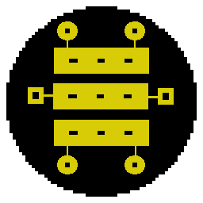
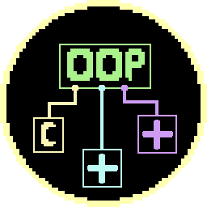
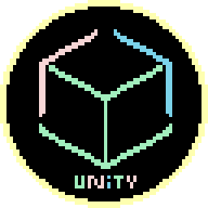

##

<h3 align="center">Hello, I'm Heloisa Pazeti!</h3>

  I'm a Computer Engineering student at the <b>University of São Paulo (USP)</b>, 
  currently on an exchange program at <b>École nationale supérieure d'arts et métiers (ENSAM)</b>. 
  Take a look at some of my best work below!

  <b>Living in:</b> France   
  <b>Languages:</b> Portuguese (Native), English (Fluent), French (Fluent)

  &nbsp;

##

  

<!-- ========== C ========== -->

### C Projects

- [Data Structures](https://github.com/heloisaPazeti/EstruturaDeDados)

 

<!-- ========== C++ ========== -->

### C++ Projects

- [Basic C++ Lessons](https://github.com/heloisaPazeti/Basic_Cplusplus_Lessons/tree/main)
- [Basic RPG](https://github.com/drdbrioso/trabalhoFinalPOO2024)

 

<!-- ========== C# / UNITY ========== -->

### C# And Unity Projects

- [Mechanics](https://github.com/heloisaPazeti/UnityMechanics2D)
- [Dialog System](https://github.com/heloisaPazeti/DialogSystemTest)
- [Space War - Infinity Run](https://github.com/heloisaPazeti/SpaceWar)
- [Turn Based Game](https://github.com/heloisaPazeti/Unity-Turn-Based-Game)

 

<!-- ========== PYTHON ========== -->

### Python Projects

- [Data Analysis and Mathematical Functions](https://github.com/heloisaPazeti/Calc_Numeric)
- [Machine Learning Basics](https://github.com/heloisaPazeti/Machine_Learning_Basics/tree/main)

 

