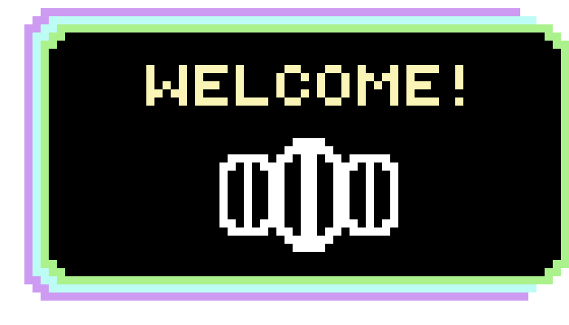

##

<h3 align="center">Hello, I'm Heloisa Pazeti!</h3>

  I'm a Computer Engineering student at the <b>University of São Paulo (USP)</b>, 
  currently on an exchange program at <b>École nationale supérieure d'arts et métiers (ENSAM)</b>. 
  Take a look at some of my best work in my portfolio below!

  <b>Living in:</b> France   
  <b>Languages:</b> Portuguese (Native), English (Fluent), French (Fluent)

  &nbsp;

